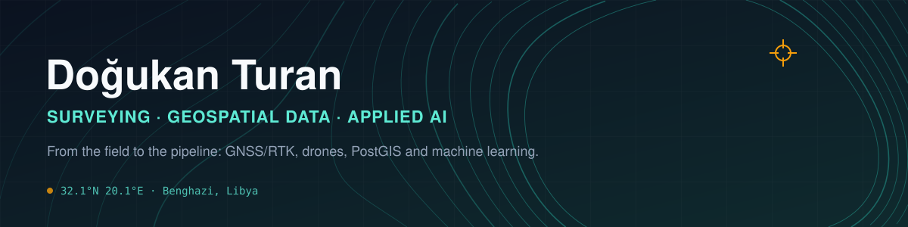

<p align="center">
  
</p>

<p align="center">
  <a href="mailto:tdogukan470@gmail.com"></a>
  <a href="https://www.kaggle.com/doukanturan"></a>
  
</p>

---

### 📍 About

I'm a **survey and mapping technician** with nearly four years on construction sites, now building the software side of the same work: geospatial data pipelines, web maps and applied machine learning.

My site experience spans hotels in Didim and Antalya (Land of Legends), about **1,800 earthquake-recovery housing units across three sites in Hatay**, and currently the **Juliana Lake coastal infrastructure and landscape project in Benghazi, Libya**. There I handle control networks, setting-out, traverse and levelling adjustments, and bathymetric surveys.

That background is what I bring to code. I know where coordinates come from, what a datum shift looks like in real data, and why a closing error matters.

```yaml
focus:      geospatial data engineering · web GIS · applied ML
field:      GNSS/RTK · total station · UAV photogrammetry · bathymetry
datums:     TUREF / ITRF · ED50 · Libyan LTM
education:  A.Sc. Mapping & Cadastre — Atatürk University (2022)
            B.A. Labour Economics (in progress, distance learning)
languages:  Turkish (native) · English
```

---

### 🛰️ Selected work

| Project | What it is | Stack |
|---|---|---|
| **Koordinat GİT** | Offline-first PWA for converting between Turkish and Libyan coordinate systems in the field, with no signal needed | JavaScript · PWA · Netlify |
| **Mapping-equity analysis** *(Zindi Bias Bounty)* | Predicted map-coverage gaps for 9,794 US census tracts from Overture Maps. Found that tract boundaries often follow highway centrelines, which double-counts roads in the reference data, and corrected it with measured boundary buffers verified in QGIS. | DuckDB Spatial · GeoPandas · QGIS |
| **solarfil** *(Solar Filament Segmentation 2026)* | Instance segmentation of solar filaments in full-disk H-alpha images: limb-darkening correction, multi-annotator soft targets, U-Net / UNet++ ensembles, Panoptic-Quality-tuned post-processing | PyTorch · segmentation-models · OpenCV |
| **Speed Travels** *(NFL Big Data Bowl 2027)* | Linked Combine 10 Hz tracking data to in-game pass-rush outcomes, with causal mediation, selection-bias correction and FDR control | Python · statsmodels · LightGBM |
| **AeroMind** | ICAO radiotelephony trainer: an AI control tower, item-by-item readback grading and coaching in 6 languages | JS · Cloudflare Pages · Whisper |
| **KlinikSes** | WhatsApp AI receptionist that books clinic appointments automatically | n8n · Claude API · WhatsApp Business API |
| **Site tooling** | Telegram bot turning WhatsApp site logs into daily reports, plus progress dashboards and a trilingual (TR/AR/EN) field guide | Python · Telegram API |

**In progress:** *Juliana Lake Mapper*, a drone-to-orthophoto pipeline into PostGIS, served through FastAPI on a MapLibre web map.

---

### 🧰 Toolbox

**Geospatial**
<br>


**Data & ML**
<br>


**Build & ship**
<br>


**Field hardware**
<br>


---

### 🧭 Where I'm heading

Becoming a **geospatial data engineer**: pipelines that take raw field and drone data all the way to clean spatial databases and maps people can use. I'm especially interested in the overlap of surveying, remote sensing and machine learning.

📫 For remote GIS, geospatial or data roles and freelance survey-data work, reach me at **tdogukan470@gmail.com**.
